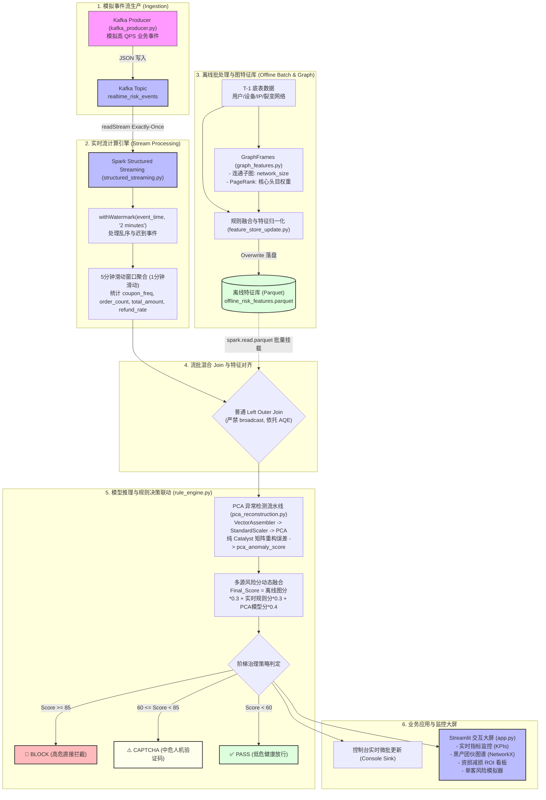

# 02_Risk_Growth_Integrity | 全流程流批一体风控架构流水线 (Pipeline)

本文档详细说明了「实时风险拦截与黑产团伙挖掘系统」从高 QPS 订单事件接入、离线图拓扑特征计算、流批混合 Join 到实时多源决策与拦截输出的端到端技术流水线。

---

## 一、 整体数据流向与系统架构图

---

## 二、 核心数据字典 (Data Dictionary)

### 1. 实时事件流表：`realtime_risk_events` (Kafka Payload)
记录网关上报的单笔业务交易与营销动作事件原始流水。

| 字段名 | 数据类型 | 允许空值 | 业务含义说明 | 示例值 |
| :--- | :--- | :---: | :--- | :--- |
| `device_id` | String | 否 | 客户端设备指纹 ID (唯一标识一台终端) | `"dev_gang_01"` |
| `action` | String | 否 | 用户业务行为类型：`coupon` (领券), `order` (下单), `refund` (退单) | `"coupon"` |
| `amount` | Double | 否 | 单笔业务涉及交易金额 (领券时固定为 0.0) | `1280.00` |
| `event_time` | Timestamp | 否 | 事件发生的业务时间戳 (Event Time)，用于 Watermark 窗口时间对齐 | `"2026-10-15 14:30:00"` |

---

### 2. 离线图特征库：`offline_risk_features.parquet` (Feature Store)
由 GraphFrames 批处理流水线每日定时产出，回填至本地特征湖供实时流 Join 调用。

| 字段名 | 数据类型 | 业务含义说明 | 计算口径与技术来源 | 示例值 |
| :--- | :--- | :--- | :--- | :--- |
| `feature_device_id` | String | 离线特征主键 (设备指纹 ID) | 与实时流中的 `device_id` 进行关联对齐 | `"dev_gang_01"` |
| `history_risk_score`| Double | 设备离线综合历史风险评分 (0~100) | 基于设备共用数、网络规模、PageRank 及地址相似度加权融合 | `144.20` |
| `device_shared_users` (内部)| Long | 该设备历史上绑定的独立用户账号数 | `COUNT(DISTINCT user_id) GROUP BY device_id` | `6` |
| `network_size` (内部)| Long | 设备所属团伙的最大连通子图节点规模 | GraphFrames `connectedComponents()` 统计结果 | `8` |
| `pagerank` (内部)| Double | 设备对应核心节点度数与权威度权重 | GraphFrames `pageRank(maxIter=5)` 计算结果 | `2.41` |

---

### 3. 流式窗口聚合与决策输出宽表 (Streaming Result Schema)

| 字段名 | 数据类型 | 业务含义说明 |
| :--- | :--- | :--- |
| `window` | Struct (start, end) | 当前滑动窗口的时间区间 (5分钟窗口，1分钟滑动一次) |
| `device_id` | String | 聚合统计的设备指纹主键 |
| `coupon_freq` | Long | 5分钟滑动窗口内该设备的累计领券次数 |
| `order_count` | Long | 5分钟滑动窗口内该设备的累计下单总笔数 |
| `total_amount` | Double | 5分钟滑动窗口内该设备的累计下单总金额 (¥) |
| `refund_count` | Long | 5分钟滑动窗口内该设备的累计申请退款总笔数 |
| `refund_rate` | Double | 窗口内订单退款率: `refund_count / order_count` |
| `history_risk_score`| Double | 从离线 Parquet 特征库匹配到的历史图拓扑基线分 (未匹配填充 0.0) |
| `realtime_rule_score`| Double | 实时窗口聚集规则分 (基于领券频次、退单率与金额异常加权) |
| `pca_anomaly_score` | Double | PCA 降维重构误差映射的模型异常度分 (0 ~ 100) |
| `final_score` | Double | 最终加权融合总分: `离线*0.3 + 实时*0.3 + 模型*0.4` |
| `decision` | String | 治理策略结果: `BLOCK (高危拦截)` / `CAPTCHA (人机验证)` / `PASS (放行)` |
