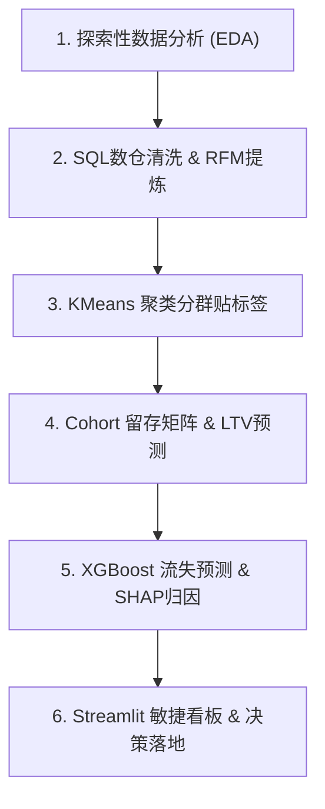

# Business Data Analytics Portfolio (电商客户分群与流失预警)

[](https://github.com/YalinZ/business_data)
[](https://github.com/YalinZ/business_data)
[](https://opensource.org/licenses/MIT)

本项目是一个工业级的商业数据分析与机器学习建模作品集，聚焦于电商领域的**客户分群 (RFM Segmentation)**、**留存追踪 (Cohort Analysis)**、**预期生命周期价值预测 (LTV Prediction)** 以及 **客户流失预测与归因 (Churn Prediction & SHAP Explainability)**。

本项目打通了从 **数仓 SQL 提炼清洗 ➡️ Python 机器学习建模 ➡️ 敏捷商业看板开发** 的全链路，提供了可直接用于支持企业增长与运营决策的闭环系统。

* 仓库地址：[https://github.com/YalinZ/business_data](https://github.com/YalinZ/business_data)

---

## 🌟 项目亮点 (Key Highlights)

* **SQL + Python 双引建模**：使用内存数仓引擎 **DuckDB** 模拟企业数仓 ETL 流程，高效完成百万级流水的清洗与 RFM 指标聚合，再无缝对接 Pandas 与 Scikit-Learn 进行数据建模。
* **经典 RFM KMeans 聚类分群**：通过 Log 变换与标准化消除偏态分布，使用 KMeans 对客群实施立体式立体划分，发掘核心价值 VIP 客户。
* **Cohort 矩阵与 LTV 建模**：追踪不同月份入客的留存热力图；拟合经典概率模型 **BG/NBD** 与 **Gamma-Gamma**，预测未来一年的期望 LTV。
* **XGBoost 预测与 SHAP 可解释性**：基于时间切片窗口，训练 `XGBClassifier` 对高危流失倾向客户进行精准拦截（测试集 Recall 达 **80.2%**）；结合 **SHAP (TreeExplainer)** 理论进行流失特征归因，打破机器学习黑箱。
* **Streamlit 敏捷商业决策看板**：轻量化前端数据存储设计，提供 KPI 指标大盘、3D RFM 分布、动态 Cohort 留存、单客流失模拟推理器（Inference）与高危客户 CRM 一键导出。

---

## 📐 通用 6 步商用分析框架

本项目严格遵循商业分析师 (BA/DA) 的工业级标准建模流程：



1. **探索性数据分析 (EDA)**：诊断原始数据，处理缺失值、冲销退货订单和零/负单价等异常值。
2. **数仓 ETL 阶段**：运用标准 SQL 进行高效的分组聚合，提取 R、F、M 基础宽表。
3. **分群貼签阶段**：特征标准化消除量纲影响，构建立体分群，揭示帕累托“二八定律”。
4. **留存与生命周期评估**：构建留存矩阵热力图，拟合 Bayesian 概率模型预测 LTV。
5. **流失预警建模**：设置观察期与预测期，提取 6 大行为特征训练分类模型，通过 SHAP 提取主导流失因子。
6. **看板决策落地**：编写 Web 看板实现交互式模拟推理与名单导出，赋能一线运营团队。

---

## 📂 目录结构树

```text
business_data/
├── .gitignore                      # Git 忽略配置文件
├── README.md                       # 项目顶级说明文档
├── requirements.txt                # 项目依赖包清单
├── 01_rfm_churn_ltv/               # 电商 RFM 分群与流失预警子项目
│   ├── .agentrules.md.txt          # AI 行为规范与准则说明
│   ├── app.py                      # Streamlit 敏捷商业看板主程序
│   ├── dataset.md.txt              # 数据字典与字段定义说明
│   ├── pipeline.md.txt             # 项目全流程 Pipeline 指引
│   ├── rfm_churn_analysis.ipynb    # 核心数据分析与建模 Jupyter Notebook
│   ├── scaler.pkl                  # 特征标准化缩放组件 (Joblib)
│   ├── todo.md.txt                 # 项目任务清单与进度看板
│   └── xgb_model.pkl               # 训练好的 XGBoost 预测分类模型 (Joblib)
└── templates/
    └── universal_analytics_prompts.md # 通用商业数据分析 Prompt 提示词模板
```

---

## ⚡ 环境安装与一键启动

### 1. 克隆仓库与安装依赖
```bash
# 克隆项目
git clone https://github.com/YalinZ/business_data.git
cd business_data

# 安装依赖
pip install -r requirements.txt
```

### 2. 启动 Streamlit 商业看板
在项目根目录下直接运行以下命令：
```bash
streamlit run 01_rfm_churn_ltv/app.py
```
启动后，浏览器会自动打开 `http://localhost:8501` 呈现可视化大盘。

---

## 📊 商业 Insight 与 Actionable 建议示例

项目产出的核心分析结论如下，已深度融合到 Notebook 分析与 Streamlit 看板中：

### 1. 客户价值极化分析 (VIP 客群)
* **Insight (业务洞察)**：**高价值 VIP 客户**仅占总人数的 **20.3%**，但贡献了高达 **73.8%** 的 GMV。公司的营收极度依赖核心头部的超级客户。
* **Actionable Suggestion (业务建议)**：配备专属客服，新商品优先预览及提前预购权，生日寄送精美定制实物礼品，防止竞品挖墙脚。

### 2. 大促季冲动型买家流失 (Cohort 矩阵)
* **Insight (业务洞察)**：**2010年11月** 大促季入客在第 3 个月的留存率仅为 **9.5%**，相比平季月份的平均留存率 **21.8%** 降低了 **12.3%**。大促流量存在典型的“折扣敏感流失”规律。
* **Actionable Suggestion (业务建议)**：针对大促引流进来的客户，在首笔订单完成后的 30 天内建立“买赠/体验卡”任务式引导，力争将第 3 个月平均留存率拉升至 25% 以上。

### 3. VIP 流失驱动力归因 (SHAP 归因)
* **Insight (业务洞察)**：SHAP 分析表明，对于历史上高频购买的 VIP 客户，**“退货次数超过 2 次”** 是推高其流失概率的 TOP 诱因，体现出服务链路体验（如退货响应慢）对其忠诚度的致命杀伤力。
* **Actionable Suggestion (业务建议)**：自动触发流失概率 > 75% 且 LTV 居前 20% 的“高危高价值”客户工单给专属 VIP 客服成功团队，在 48 小时内进行电话人工回访，主动补偿大额无门槛券并跟进退换货体验。
